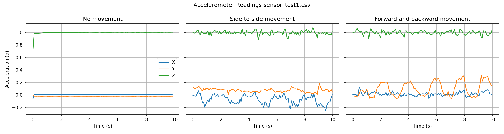

# Wearable Safety System

A final year project focused on developing a wearable safety prototype for older adults.

The idea is to detect possible falls using motion sensors. If a fall is detected, the device will ask the user if they are okay, and if there is no response, it will alert a trusted contact. This is a prototype for a university project, not a medical device.

## Current Stage

The project is currently in the early development stage. The research and the first sensor tests are complete, but no fall detection method has been built yet and no real falls have been recorded.

## Current Research

I am currently looking into:
- How wearable devices can detect falls
- Accelerometer and gyroscope data
- The difference between normal movement and fall-like movement
- False alarms
- Simple detection rules and machine learning

My research summary is in `docs/research/fall_detection_research_summary.md`.

## Completed So Far

**Sensor testing with Raspberry Pi and Sense HAT**
- `read_sensors.py` prints one accelerometer and gyroscope reading.
- `sensor_data.py` records readings for three movements (no movement, side to side, forward and backward) for 10 seconds each, and saves them to `sensor_test_01.csv`.

**Data analysis**
- `plot_sensor_test.py` plots the accelerometer readings for each movement.



Each movement shows a different pattern: the X axis changes during side to side movement, and the Y axis during forward and backward movement. These were small hand movements, not falls.

## Planned System

This is the planned design. The planned M5StickS3 system has not been implemented yet.

1. **Sensing** – the M5StickS3 reads its accelerometer and gyroscope. It also has a help button.
2. **Processing** – detect possible falls. I plan to compare a threshold method with machine learning. It is not decided yet whether this will run on the device or on a server.
3. **Check-in** – the device asks "Are you OK?" on its screen, and the user answers with the button.
4. **Communication** – if there is no answer, or the help button is pressed, an alert is sent over Wi-Fi. The exact method is not decided yet.
5. **Application** – the alert goes to a trusted contact, and the event is saved and shown on a simple dashboard.

This structure is based on the four layers described by Wang et al. (2020): physiological sensing, local communication, information processing and user application.

I also plan to use a public dataset alongside my own data. Rodrigues et al. (2018) tested their inertial sensor fall detection system on both newly collected data and public datasets.

**Limitations of this design:**
- The M5StickS3 only has Wi-Fi, so an alert cannot be sent without a network connection.
- The battery is small (250 mAh), so I need to test how long it lasts.
- Most fall data is simulated by young volunteers, which may not match real falls in older adults (Sucerquia et al., 2017; Wang et al., 2020).
- Where the processing runs and where the device is worn (wrist or waist) are not decided yet.

## Project Structure

```
docs/
  images/      Graphs from the test data
  research/    Research summary
src/
  analysis/    Data analysis scripts (run on a laptop)
  sense_hat/   Sense HAT scripts and test data (run on a Raspberry Pi)
```

## How to Run

**Sense HAT scripts** (on a Raspberry Pi with a Sense HAT and the `sense-hat` library):

```
cd src/sense_hat
python3 read_sensors.py
python3 sensor_data.py
```

Change the `filename` in `sensor_data.py` before recording new data, because it will not overwrite an existing file.

**Graph** (on a laptop):

```
pip install pandas matplotlib
python src/analysis/plot_sensor_test.py
```

## Hardware

- M5StickS3 – the final wearable device (not programmed yet)
- Raspberry Pi – used for the first sensor tests
- Sense HAT – used for the first sensor tests

## References

- Rodrigues, T.B. et al. (2018) 'Fall Detection System by Machine Learning Framework for Public Health', *Procedia Computer Science*, 141, pp. 358–365. https://doi.org/10.1016/j.procs.2018.10.189
- Sucerquia, A., López, J.D. and Vargas-Bonilla, J.F. (2017) 'SisFall: A Fall and Movement Dataset', *Sensors*, 17(1), 198. https://doi.org/10.3390/s17010198
- Wang, X., Ellul, J. and Azzopardi, G. (2020) 'Elderly Fall Detection Systems: A Literature Survey', *Frontiers in Robotics and AI*, 7, 71. https://doi.org/10.3389/frobt.2020.00071